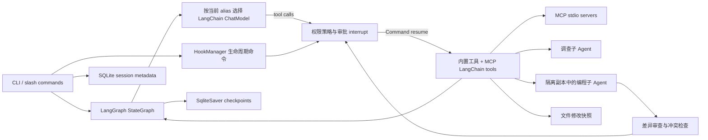

# benweiclaude

一个用 **LangChain 1.x + LangGraph 1.x** 构建的命令行智能编程助手。支持 DeepSeek、通义千问 Qwen 和 OpenAI 运行时切换、SQLite 会话恢复、40+ 工具、分层记忆、项目级 MCP 扩展、三种权限模式、文件回退、结构化上下文压缩、项目指令、任务追踪、项目技能，以及可并行调查或编程的子 Agent。

支持项目级生命周期 Hooks，可在会话、用户输入、审批、工具执行、子 Agent、上下文压缩、模型切换和回答结束时运行自定义命令。

> 项目是可运行的面试演示，不是 Claude Code 的完整复刻。模型调用和网页搜索需要网络；模型服务费用由对应服务商收取。

## 快速开始

要求 Python 3.11+。推荐 Python 3.12。

```powershell
# 在本项目目录执行
if (-not (Test-Path .env)) { Copy-Item .env.example .env }
# 编辑 .env，至少填入要使用的模型 API Key
uv sync --python 3.12 --extra dev
uv run codepilot --model qwen --show-reasoning
```

对话过程中默认流式显示模型回复、工具请求、审批、执行结果、耗时，以及子 Agent 的调度和工具进度。
`--show-reasoning` 展开服务商实际返回的推理内容；`--debug` 查看更长的工具结果及 Token 用量；`--quiet` 只看最终回复和必要的审批提示。没有公开推理字段的模型只显示可观察的执行轨迹。

也可以使用 pip：

```powershell
python -m venv .venv
.venv\Scripts\Activate.ps1
pip install -e ".[dev]"
codepilot --model qwen
```

默认工作区是启动命令时的当前目录。分析其他项目时用 `--workspace <真实存在的项目目录>`；不要原样复制尖括号中的占位说明。程序优先读取工作区的 `.env`，找不到所需配置时再读取启动目录的 `.env`，系统环境变量优先于 `.env`。工作区必须已存在。`.env` 已加入 `.gitignore`，不要提交真实 Key。

```text
DEEPSEEK_API_KEY=...
QWEN_API_KEY=...
OPENAI_API_KEY=...
```

只需要填写实际使用的模型密钥。Qwen 使用 `langchain-qwq` 的 `ChatQwen` 接入百炼，默认地址是 `https://dashscope.aliyuncs.com/compatible-mode/v1`，可通过 `QWEN_BASE_URL` 修改。`QWEN_ENABLE_THINKING=true` 默认开启 Qwen 思考模式，可设为 `false` 关闭；具体模型是否返回推理内容以服务商接口为准。`SUBAGENT_MODEL` 可指定已配置密钥的模型别名；留空时使用主 Agent 当前模型。模型名称也可通过 `DEEPSEEK_MODEL`、`QWEN_MODEL`、`OPENAI_MODEL` 修改。

### 常用交互

```text
codepilot> 帮我分析这个项目的入口和测试结构
codepilot> 为这个函数补上边界条件，修改后运行相关测试
codepilot> /model qwen
codepilot> 继续刚才的问题
codepilot> /resume
codepilot> /resume 65a321bc
codepilot> /history
codepilot> /mode plan
codepilot> 帮我调查登录模块并提交修改计划
codepilot> /mode default
codepilot> /rewind
codepilot> /rewind 8f21c0e7
codepilot> /context
codepilot> /compact
codepilot> /todo
codepilot> /memory status
codepilot> /memory search JWT认证
codepilot> /rename 登录模块重构
codepilot> /status
codepilot> /agents
codepilot> /tools
codepilot> /skills
codepilot> /hooks
codepilot> /mcp
codepilot> /new openai
codepilot> /quit
```

启动时自动创建会话；`/resume` 不带参数列出会话，带 ID 或唯一前缀恢复。也可直接 `codepilot --resume <id>`。`/model` 切换时检查对应密钥，保留同一 `thread_id` 下的消息。`--once "问题"` 可发送单次请求，若模型请求写入或执行命令，仍会在终端要求审批。

### 类似 Claude Code 的工作流

| 功能 | 用法 | 行为 |
|---|---|---|
| 权限模式 | `/mode default`、`/mode acceptEdits`、`/plan`；启动时可用 `--mode` | 默认模式逐项审批修改和命令；`acceptEdits` 自动接受常见文件编辑，删除和 shell 命令仍需审批；计划模式只允许调查与提交计划。模式随会话保存。 |
| 变更预览 | 模型申请修改文件时自动显示 | 审批前展示有上限的 unified diff。 |
| 文件回退 | `/rewind` 列出检查点，`/rewind <ID>` 回退 | 对内置写入、编辑、追加、删除、移动、复制工具保存修改前文件。发现文件之后被外部修改时拒绝覆盖。 |
| 分层记忆 | `/memory status/list/search/show/forget/compact` | 近期消息保存在 LangGraph 状态；结构化摘要随 checkpoint 恢复；项目长期记忆保存来源、关联文件、重要度和可信度，并通过 FTS5 与中文词法回退按需注入。长期记忆写入、更新和遗忘需要审批。 |
| 上下文管理 | `/context`、`/compact` | 按可配置 Token 预算触发增量结构化摘要，保留最近安全消息；默认上下文上限可用 `CODEPILOT_CONTEXT_LIMIT` 调整。 |
| 项目指令 | 工作区根目录的 `AGENTS.md`、`CLAUDE.md`、`CODEPILOT.md` | 每次模型调用重新读取，修改后无需重启。 |
| 任务记忆 | `/todo`；`todo_create/update/complete/list/remove` | 按会话保存到 SQLite，并在每次模型调用时自动注入未完成进度；旧 `.codepilot/todo-<session>.json` 首次读取时自动迁移。 |
| 会话管理 | `/rename`、`/status`、`/resume` | 给会话命名、查看状态、重启后继续。 |
| 并发保护 | 同一个 `thread_id` 单写者 | `send`、审批、压缩、回退和会话设置使用跨进程 SQLite 租约；第二个进程仍可读取历史，但写操作会提示占用。租约带心跳，进程崩溃后可过期接管。 |
| 工具幂等 | `/executions` 查看执行日志 | 每个 `session_id + tool_call_id` 在副作用前写入日志；已完成调用复用原结果，中断后结果不确定的调用不会自动重复执行。 |
| 进程沙箱 | `run_command`、Hooks、MCP Server | 统一使用无 Shell 执行器和最小环境；限制运行时间、输出、内存和进程数，超时后清理整个进程树。Windows 使用 Job Object，POSIX 使用独立进程组与资源限制。 |
| 调查子 Agent | 对主 Agent 提出可拆分的调查任务 | `delegate_agent` 或 `delegate_agents`；后者并行派遣 2 至 3 个只读 Agent，各自调查后向主 Agent 返回结论。 |
| 编程子 Agent | 要求把独立的编程任务分配给子 Agent | `delegate_coding_tasks` 同时派遣 1 至 3 项任务。每项给出明确目标和不重叠的可写路径；子 Agent 在隔离副本内修改。主 Agent 用 `review_subagent_changes` 看差异，用 `apply_subagent_changes` 请求合并审批，再运行测试和汇总。`/agents` 查看任务状态。 |
| MCP | `.mcp.json`；`codepilot mcp add/list/get/remove`；会话内 `/mcp` | 读取项目级 MCP stdio server，调用 `initialize`、`tools/list`、`tools/call`，把远端工具转换成 `mcp__server__tool` 形式的 LangChain 工具。MCP 工具默认需要审批，计划模式拒绝执行。 |
| Hooks | 工作区 `.codepilot/hooks.json`；`/hooks` 查看并重新加载 | 生命周期事件触发外部命令。可阻止用户输入、工具执行、审批、子 Agent 派遣、压缩、模型切换或要求模型继续回答。 |

### 工作区信任

项目级 `.mcp.json` 和 `.codepilot/hooks.json` 可以启动本地进程，因此 CodePilot 默认把包含这些配置的新工作区视为不受信任。首次启动会展示配置文件和将要运行的命令；选择 `y` 仅为本次启用，选择 `a` 会把工作区路径和配置内容指纹记录到用户目录的 `~/.codepilot/trusted_workspaces.json`。拒绝或非交互输入时，普通文件分析仍可使用，但 Hooks 和 MCP 保持禁用。

信任与配置内容绑定：任一可执行配置发生变化，当前运行和下次启动都会停止执行，并要求重新确认。会话中可用 `/trust status` 查看状态、`/trust enable` 重新授权、`/trust revoke` 撤销信任。启动参数 `--trust-workspace` 用于明确授权并记住当前指纹，`--no-trust-workspace` 强制安全模式。信任记录位于项目外，仓库不能通过修改自身文件授予自己信任。

### 进程沙箱

`run_command`、命令型 Hook 和 MCP Server 共用 `SandboxRunner`。它使用参数数组直接启动程序，Shell 管道、重定向和命令连接符不会被解释；同时仅继承最小系统环境，额外变量必须显式授权。每个任务都有墙钟超时和输出上限，Windows 通过 Job Object 限制内存、进程数并在退出时清理进程树，POSIX 使用独立进程组和 `rlimit`。Linux 检测到 bubblewrap 后会增加只读宿主根目录、独立 `/tmp`、PID/IPC/UTS/cgroup namespace，并默认断开网络；工作区按策略单独绑定。`/sandbox` 显示当前平台能力。设置 `CODEPILOT_SANDBOX_STRICT=1` 后，缺少文件系统或网络强隔离后端时会终止任务启动。

文件回退覆盖内置文件工具和已合并的编程子 Agent 文件变化，不覆盖 `run_command`、`make_directory`、外部程序或远程系统。`/rewind` 回退文件并在会话中加入一条通知，不回退整个对话。文件编辑或回退会使关联的长期记忆失效，避免继续注入过期代码事实。`/compact` 需要一次额外模型调用，会产生相应费用；`/context` 的 Token 数只是估算值。

### 编程子 Agent 的调度与合并

例如输入：“把 `src/api/` 的参数校验和 `tests/api/` 的测试补充分给两个编程子 Agent，分别限定可写目录；先审查两个差异，再申请合并，运行测试后总结。”主 Agent 会把两个任务发到独立副本，保留代码变更记录。副本位于工作区 `.codepilot/subagents/<任务ID>/`，重启后仍可通过 `/agents` 查看。合并前会核对副本内容、写入范围和主工作区是否在派遣后被修改；有冲突就拒绝覆盖。合并仍需人工审批，包括 `acceptEdits` 模式。子 Agent 没有 shell 工具；测试由主 Agent 合并后执行。

编程任务每批最多 3 项，工作区副本上限为 2000 个文件或 40 MB。超过上限、依赖同一文件的任务，应由主 Agent 串行处理。隔离副本会跳过密钥、Git 元数据、依赖缓存与本项目状态库。

### MCP 工具扩展

MCP 配置放在工作区根目录 `.mcp.json`，格式与 Claude Code 的项目级配置保持一致：

```json
{
  "mcpServers": {
    "example": {
      "command": "python",
      "args": ["path/to/server.py"],
      "networkMode": "unrestricted",
      "envAllowlist": ["API_KEY"],
      "env": {
        "API_KEY": "${API_KEY}"
      }
    }
  }
}
```

也可以用命令写入配置：

```powershell
uv run codepilot mcp add example -- python path/to/server.py
uv run codepilot mcp list
uv run codepilot mcp get example
uv run codepilot mcp remove example
```

会话内输入 `/mcp` 会重新连接 server、刷新工具列表并显示状态。连接成功后，MCP 工具会以 `mcp__<server>__<tool>` 的名字加入模型可见工具，例如 `mcp__github__create_issue`。调用时 CodePilot 复用对应 stdio server，通过换行分隔的 JSON-RPC 发送 `initialize`、`tools/list` 和 `tools/call`，并把文本结果交回 LangGraph。Server 仅继承最小系统环境以及 `envAllowlist` 明确列出的变量；CodePilot 另外注入 `CODEPILOT_PROJECT_DIR` 和 `CLAUDE_PROJECT_DIR`。

当前实现支持 stdio MCP server；HTTP、SSE、OAuth、资源和 prompts 还未实现。Windows 上运行 npm MCP server 时，通常需要像 Claude Code 一样使用 `cmd /c` 包一层，例如：

```powershell
uv run codepilot mcp add my-server -- cmd /c npx -y @some/mcp-server
```

MCP 和 Hook 的区别：MCP 是给模型增加外部工具；Hook 是在本地 Agent 生命周期里做拦截和反馈。MCP 工具默认进入人工审批，计划模式下被拒绝执行。

### 生命周期 Hooks

Hook 配置放在工作区的 `.codepilot/hooks.json`，默认不存在，因此不会运行外部命令。配置采用 Claude Code 风格的 `事件 → matcher 组 → command 处理程序` 结构。目前支持命令型 Hook；命令及参数以数组形式执行，不经过 shell，并经过统一进程沙箱。脚本在工作区运行，从标准输入读取 JSON 事件，超时默认为 10 秒，最多 120 秒。需要额外环境变量时，在处理程序中设置 `envAllowlist`。`/hooks` 显示并重新加载配置。示例见 [examples/hooks.json](examples/hooks.json) 和 [examples/hooks/block_delete.py](examples/hooks/block_delete.py)。

```powershell
New-Item -ItemType Directory -Force .codepilot | Out-Null
Copy-Item examples/hooks.json .codepilot/hooks.json
uv run codepilot --model qwen
# 输入 /hooks 查看已加载的事件
```

此示例在 `delete_file` 执行前检查路径。如果目标在 `src/` 下，脚本输出 `permissionDecision: deny`，Agent 会收到拒绝原因，文件不会删除。对需要人工审批的调用，审批仍先由 LangGraph `interrupt()` 暂停；批准后才执行 `PreToolUse` 与工具，因此审批恢复不会重复运行执行型 Hook。`PermissionRequest` 在 CLI 展示审批时触发，可以提前拒绝；它不负责批准绕过用户确认。

支持的事件：

| 事件 | 时机 | 可阻止 |
|---|---|---|
| `SessionStart`、`SessionEnd` | 新建/恢复会话、关闭程序 | 否 |
| `UserPromptSubmit` | 用户输入进入图之前 | 是 |
| `PermissionRequest` | CLI 请求人工审批之前 | 是 |
| `PreToolUse` | 已满足权限要求、工具执行之前 | 是 |
| `PostToolUse`、`PostToolUseFailure` | 工具成功或失败后 | 否；可追加模型可见的反馈 |
| `SubagentStart`、`SubagentStop` | 派遣和结束子 Agent | 只有 Start 可阻止 |
| `PreCompact`、`PostCompact` | 上下文压缩前后 | 只有 Pre 可阻止 |
| `PreModelSwitch`、`PostModelSwitch` | 模型切换前后 | 只有 Pre 可阻止 |
| `Stop` | 模型准备结束回答 | 是；最多要求额外继续两次 |

工具事件的输入包含 `hook_event_name`、`session_id`、`cwd`、`tool_name`、`tool_input`、`tool_use_id`；其他事件附带相应的 `prompt`、`model`、`agent_type` 等字段。命令退出码 `0` 表示正常；输出 `{"decision":"block","reason":"原因"}` 可阻止表中允许阻止的事件，`PreToolUse` 也接受 Claude Code 风格的 `hookSpecificOutput.permissionDecision: "deny"`。退出码 `2` 会用 stderr 作为阻止原因。输出 `additionalContext` 可向模型追加上下文，`PostToolUse` 的反馈会进入工具消息。命令超时、找不到或输出无效时会打印 Hook 错误并继续正常流程。

Hook 命令运行在本机工作区，默认只获得最小系统环境和项目目录变量；额外变量必须通过 `envAllowlist` 明确授权。当前实现覆盖本项目已有的生命周期节点，并不支持 Claude Code 的 HTTP、prompt、agent 类型 Hook，也不宣称与其完整协议兼容。

## 架构



关键源码：[入口](src/codepilot/cli.py)、[对话图](src/codepilot/agent.py)、[记忆系统](src/codepilot/memory.py)、[Hooks](src/codepilot/hooks.py)、[工具](src/codepilot/tools.py)、[模型](src/codepilot/models.py)、[存储](src/codepilot/storage.py)。完整设计、原理、工具清单和面试问答见 [docs/INTERVIEW_GUIDE.md](docs/INTERVIEW_GUIDE.md)。

## 项目技能

把项目技能放在工作区的 `.benwei/skills/<name>/SKILL.md`。`list_skills` 和 `read_skill` 工具可以发现并读取。技能文本会被视为外部内容，不能覆盖系统级指令。仓库提供了 [示例技能](examples/skills/code-review/SKILL.md)。

## 验证

```powershell
uv run pytest -q
uv run codepilot --help
uv run python scripts/evaluate_metrics.py --output evaluation/latest.json
uv run --extra dev python scripts/quality.py
```

自动测试使用假模型，不需要 API Key；真实模型联调需要有效密钥和网络。
工程基准同样不需要 API Key，输出会话恢复、记忆召回、Rewind、Hook、MCP 和子 Agent 并行指标。当前基线、测试边界与后续验收目标见 [项目评测报告.md](项目评测报告.md)。

`scripts/quality.py` 与 GitHub Actions 执行同一组质量门禁：Ruff 基础静态检查、关键基础模块 mypy 类型检查，以及带分支统计的 pytest 覆盖率。当前最低覆盖率门槛为 75%；82 项自动测试的本地分支覆盖率为 79.43%，其中 CLI 为 72%、`tools.py` 为 87%、沙箱执行器为 79%。CI 在 Windows/Linux 和 Python 3.11/3.12 上运行。
